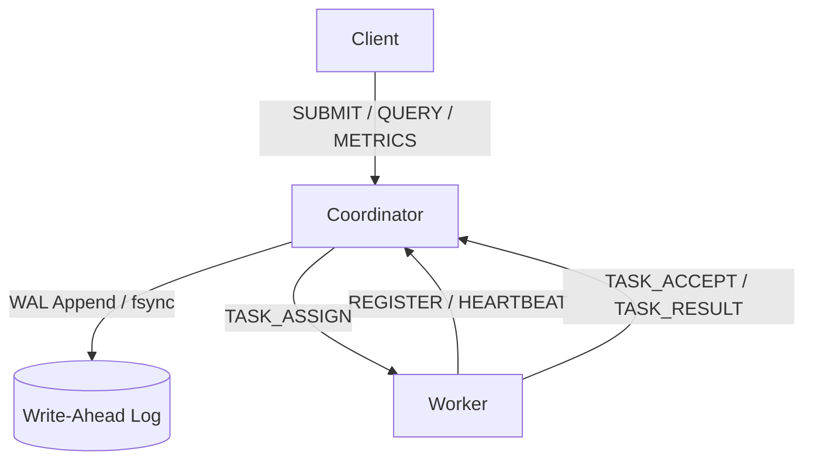

# Intelligent Distributed Runtime (IDR)

[](https://github.com/pavankumargP6/intelligent-distributed-runtime/actions/workflows/ci.yml)

IDR is a fault-tolerant, distributed task execution engine written in C. Built with Linux system programming primitives (sockets, `fork / execvp`, `poll`, signals, and a length-prefixed TCP protocol), it is designed to handle high-concurrency task bursts with strict durability guarantees, secure client/worker authentication, and a resource-aware scheduler.

## Architecture

The system follows a Coordinator-Worker architecture. The Coordinator manages state, handles scheduling, and writes to a Write-Ahead Log (WAL) for crash recovery. Workers pull tasks, report heartbeats, and manage process lifecycles.



## Core Features

*   **Fault Tolerance:** Write-Ahead Logging (WAL) with crash recovery, WAL compaction, and worker reincarnation detection.
*   **Secure Networking:** TCP sockets secured with HMAC-SHA256 authentication, role-specific secrets, and replay protection.
*   **Resource-Aware Scheduling:** O(q) scan-and-swap scheduling that prevents Head-of-Line (HOL) blocking and distributes tasks fairly across workers.
*   **Process Isolation:** Tasks are executed in separate process groups (`setpgid`). Timeouts and failures use `kill(-pid)` to ensure descendant processes are terminated, leaving no orphans.
*   **Observability:** Real-time metrics client (`client_metrics`) and `STATUS` replies exposing throughput, latency, and active worker counts.

## Performance & Benchmarks

The IDR coordinator is built to handle high-concurrency task bursts efficiently. Below are the results from a benchmark run using 4 local workers processing a queue of 1,000 no-op tasks.

**Hardware:** WSL2, Ubuntu (Windows 11 host)  
**Workload:** 1,000 tasks / 4 workers

| Metric | p50 (Median) | p95 (Tail) |
| :--- | :--- | :--- |
| **End-to-End Latency** | 15 ms | 29 ms |
| **Queue Wait Time** | 4 ms | 17 ms |

*   **Submission Throughput:** 3,618 tasks/sec
*   **Completion Throughput:** 1,000 tasks/sec (wall-clock)

## Protocol

Framing: `[4-byte network-order uint32 payload length][payload]`.
This section is a summary. The canonical reference is in `docs/PROTOCOL.md`. Payloads are newline-free ASCII. Variable-length string fields are length-prefixed as `<len>:<bytes>`.

*   **Submit a task:** `SUBMIT|<command_len>:<command>||argc||...args...|<idempotent>|<timeout_sec>`
*   **Task Assignment:** `TASK_ASSIGN||task_id||<command>|<argc>||...args...|<timeout_sec>`
*   **Result:** `TASK_RESULT|<task_id>||worker_id>||exit_code|<state>`
*   **State Codes:** `0=CREATED, 1=RUNNING, 2=COMPLETED, 3=FAILED, 4=TIMED_OUT``

**Example:** `SUBMIT|4:echo|2|5:hello|5:world|0|0`

## Authentication

Every message on the wire is signed with HMAC-SHA256 by default. The signed form is:
`<original_message>|<timestamp>|<hex_hmac>`

*   **Secure mode (default):** Requires `IDR_WORKER_SECRET` and `IDR_CLIENT_SECRET` (min 32 bytes). Every incoming message is verified, and outgoing responses are signed. Timestamps are checked with a 60-second replay window.
*   **Insecure development mode:** Enabled by `IER_INSECURE=1`. Authentication is disabled, and the coordinator requires a loopback bind address.

*Note: HMAC authenticates but does not encrypt. The wire is still plaintext. TLS is out of scope for this version.*

## Building & Running

Everything builds with `gcc -Wall -Wextra`. No external dependencies beyond `libc` and POSIX (`fork`, `poll`, `execv`, `signalh`).

```bash
make          # coordinator, worker, and clients -> build/
make asan     # same, with AddressSanitizer + UBSan
make test     # run the complete unit + integration test suite
make clean    # remove build/
```

**Three terminals to run:**
```bash
# Terminal 1
```bash
# Terminal 2
./build/worker_agent 1
```
```bash
# Terminal 3
./build/client_submit echo hello world     # Response: SUBMIT_ACK|1
./build/client_query 1                     # Response: QUERY_RESULT|1|1|0|2
```

## Limitations & Future Work

*   **Coordinator High Availability:** The coordinator is currently a single point of failure. A future iteration will implement Raft consensus for multi-node failover.
*   **Transport Encryption (TLS):** Authentication is enforced, but the wire protocol is currently plaintext.
*   **Strict Sandboxing:** Tasks run as direct child processes. True container isolation via Linux Namespaces and cgroups is planned for a future version.
*   **Executor Crash Detection:** If a worker's heartbeat continues but its forked task child segfaults, the coordinator relies on the task's `timeout_seconds` to detect the hang. A worker-side signal is required for instantaneous detection.

## License

This project is licensed under the MIT License. See the ``LICENSE` file for details.
