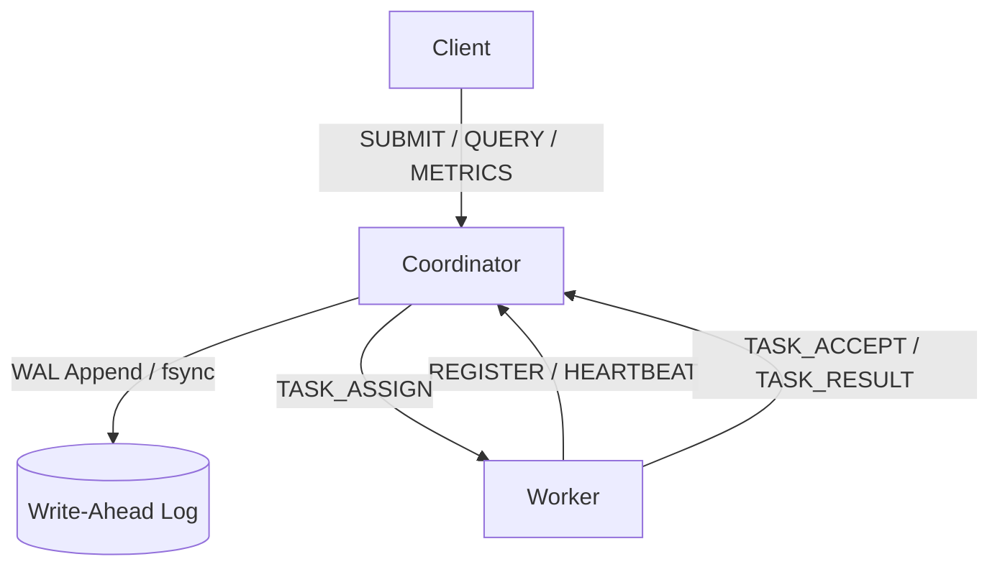

# Intelligent Distributed Runtime (IDR)

[](https://github.com/pavankumargp6/intelligent-distributed-runtime/actions/workflows/ci.yml)
[](https://hub.xerj.org/contributors/pavankumargp6)

> **Project status: v0.2.2 (pre-1.0).**
>
> This code is a working systems demonstration of durable task
> submission, process-level execution, scheduling, and crash recovery.
> WAL 2.0 makes durability bounded and crash-tested (1,000,000 lifetime
> tasks, restart every 10,000 tasks, 1 ms recovery), and uncertain
> non-idempotent outcomes return
> `TASK_UNKNOWN` instead of being silently retried. It is **not**
> production-ready: capacities are still demo-scale, transport is
> plaintext, and there is a single coordinator. See
> [Status and limitations](#status-and-limitations) and
> [`docs/ROADMAP.md`](docs/ROADMAP.md) for the path to 1.0.

IDR is a distributed task execution engine written in C for Linux. It
uses sockets, `fork / execvp`, `poll`, signals, and a length-prefixed TCP
protocol. A single coordinator durably records accepted tasks in a
write-ahead log (WAL) and dispatches them to worker agents that pull
work. HMAC-SHA256 authenticates clients and workers, and a small JSON
endpoint feeds an optional dashboard.

## Architecture

The system follows a Coordinator-Worker architecture. The Coordinator manages state, handles scheduling, and writes to a Write-Ahead Log (WAL) for crash recovery. Workers pull tasks, report heartbeats, and manage process lifecycles.



### Execution flow

1. **Submit:** A client sends a task request to the coordinator.
2. **Validate and queue:** The coordinator validates the message,
   applies authentication in secure mode, and records accepted
   tasks using its write-ahead log (WAL).
3. **Schedule:** The scheduler assigns available work to registered
   workers.
4. **Execute:** A worker launches the command and reports the
   result to the coordinator.
5. **Observe:** Clients can query task results and runtime status;
   the metrics endpoint supplies data to the dashboard.

## Core Features

*   **Bounded, crash-tested durability:** WAL 2.0 uses framed,
    CRC-protected segments, atomic snapshots, and a manifest. Recovery
    replays the snapshot plus the segment tail in about 1 ms after
    1,000,000 lifetime tasks, with a restart every 10,000 tasks and
    bounded peak RSS (42 MB across 100 in-process restarts; 3.7 MB for
    a single restart). Seven injected crash points, torn tails, mid-file
    corruption, corrupt manifests, unknown format versions, and missing
    segments are covered by tests. See [Durability](#durability) and
    [`docs/BENCHMARK.md`](docs/BENCHMARK.md).
*   **Authenticated networking:** TCP sockets with HMAC-SHA256
    authentication, role-specific secrets, timestamp checks, and replay
    protection. Messages are authenticated but not encrypted.
*   **Capacity-aware scheduling:** O(q) scan-and-swap scheduling that
    skips tasks a worker cannot fit, avoiding Head-of-Line (HOL)
    blocking. Availability is currently a static value from
    registration, not a live load measurement.
*   **Process isolation:** Tasks run in their own process group
    (`setpgid`). Timeouts and failures use `kill(-pid)` to terminate
    descendant processes. An experimental namespace/`chroot` sandbox is
    available but is not a security boundary.
*   **Observability:** A JSON metrics endpoint, `client_metrics`, and
    `STATUS` replies exposing queue depth, task counters, and active
    worker counts.

## Documentation

| Document | What it covers |
|---|---|
| [`docs/PROTOCOL.md`](docs/PROTOCOL.md) | Wire framing, field encoding, authentication, message catalog, state machine |
| [`docs/SEMANTICS.md`](docs/SEMANTICS.md) | Task lifecycle, acknowledgement contract, timeout and crash behavior, delivery guarantees |
| [`docs/ARCHITECTURE.md`](docs/ARCHITECTURE.md) | Components, task flow, durability, scheduling, failure table, limits |
| [`docs/THREAT_MODEL.md`](docs/THREAT_MODEL.md) | Assets, trust boundaries, adversaries, current gaps, mitigations |
| [`docs/SLO.md`](docs/SLO.md) | Proposed v1.0 SLIs, SLOs, error budget, measurement plan |
| [`docs/BENCHMARK.md`](docs/BENCHMARK.md) | Benchmark methodology, raw runs, and caveats |
| [`docs/ROADMAP.md`](docs/ROADMAP.md) | Phases 0-7, exit criteria, and the two 10/10 finish lines |
| [`docs/RELEASES.md`](docs/RELEASES.md) | Versioning, compatibility, deprecation, release checklist |
| [`docs/adr/`](docs/adr/) | Architecture decision records for durability, semantics, and identity |

The documents separate **current v0.2 behavior** from **v1.0 target
behavior**. If code and documentation disagree, that is a bug.

## Performance & Benchmarks

**Known limitation:** the benchmark harness counts roughly 50-90 TCP
connections per task because every request and response uses a new
connection. Worker polling dominates the churn. Persistent connections
with proper outgoing queues are future work (Phase 3).

The table below is the canonical current result: 4 client processes, 4
local workers, 1,000 `/bin/true` tasks, default worker poll interval.

**Hardware:** WSL2, Ubuntu (Windows 11 host)  
**Workload:** 1,000 no-op tasks / 4 clients / 4 workers

| Metric | p50 (Median) | p95 (Tail) |
| :--- | :--- | :--- |
| **End-to-end latency** | 17 ms | 19 ms |
| **Queue wait time** | 15 ms | 17 ms |

The run used about 53,500 connections. Submission and completion rates
are **not** reported as throughput figures: the wall-clock timer has
one-second resolution and the batch finishes in under two seconds, so
the raw rates are quantized. See
[`docs/BENCHMARK.md`](docs/BENCHMARK.md) for the full runs, the
`sleep 1` workload, the poll-interval sweep, and the methodology
caveats.


## Live Observability Dashboard

The runtime includes a built-in, real-time observability dashboard.
1. Start the coordinator: `IDR_INSECURE=1 ./build/runtime_server`
2. Serve the dashboard: `cd dashboard && python3 -m http.server 8000`
3. Open `http://localhost:8000` in your browser.

The coordinator exposes a read-only JSON endpoint at `http://127.0.0.1:8080/api/metrics`. The dashboard polls this endpoint every second to display live queue depth, active workers, and task completion metrics.

## Protocol

Framing: `[4-byte network-order uint32 payload length][payload]`.
This section is a summary. The canonical reference is in
`docs/PROTOCOL.md`. Payloads are ASCII text; a length-prefixed field may
contain any byte, including `|` and newlines. Variable-length string
fields are encoded as `<len>:<bytes>`, where `<len>` is the byte count.

*   **Submit a task:** `SUBMIT|<len>:<cmd>|<argc>|<len>:<arg1>|...|<idempotent>|<timeout_seconds>`
*   **Task assignment:** `TASK_ASSIGN|<task_id>|<len>:<cmd>|<argc>|<len>:<arg1>|...|<timeout_seconds>`
*   **Task acceptance:** `TASK_ACCEPT|<task_id>`
*   **Result:** `TASK_RESULT|<task_id>|<worker_id>|<exit_status>|<state>`
*   **Query:** `QUERY|<task_id>`, answered with `QUERY_RESULT`, `QUERY_PENDING` (queued or in flight), `QUERY_EXPIRED`, or `QUERY_UNKNOWN`
*   **State codes:** `0=CREATED, 1=RUNNING, 2=COMPLETED, 3=FAILED, 4=TIMED_OUT`

`<len>` is the byte count of the field that follows, for example `4:echo`.
The `idempotent` and `timeout_seconds` trailer fields are optional and
default to `0`.

**Example:** `SUBMIT|4:echo|2|5:hello|5:world|0|0`

## Authentication

Every message on the wire is signed with HMAC-SHA256 by default. The signed form is:
`<original_message>|<timestamp>|<hex_hmac>`

*   **Secure mode (default):** Requires `IDR_WORKER_SECRET` and `IDR_CLIENT_SECRET` (min 32 bytes). Every incoming message is verified, and outgoing responses are signed. Timestamps are checked with a 60-second replay window.
*   **Insecure development mode:** Enabled by `IDR_INSECURE=1`. Authentication is disabled, and the coordinator requires a loopback bind address.

*Note: HMAC authenticates but does not encrypt. The wire is still plaintext. TLS is out of scope for this version.*


## Building and Running

### Requirements

- Linux (Ubuntu 22.04/24.04 or a compatible distribution)
- GCC, Make, Git and iproute2 (`ss`)
- Python 3 for the optional dashboard

Install the dependencies on Ubuntu:

```bash
sudo apt update
sudo apt install -y build-essential git iproute2 python3
```

### Clone and build

```bash
git clone https://github.com/pavankumargp6/intelligent-distributed-runtime.git
cd intelligent-distributed-runtime
make
```

Run the complete test suite:

```bash
make test
```

The build creates the coordinator, worker agent and client
executables under `build/`.

### Quick demo: local development mode

This demo disables message authentication for local development.
Use it only on the loopback interface; do not use insecure mode
for network-accessible deployments.

Open three terminals in the cloned repository.

**Terminal 1 — start the coordinator**

```bash
rm -f /tmp/idr-demo-wal.log
IDR_INSECURE=1 IDR_WAL_PATH=/tmp/idr-demo-wal.log ./build/runtime_server
```

**Terminal 2 — start a worker**

```bash
IDR_INSECURE=1 ./build/worker_agent 1
```

**Terminal 3 — submit and query a task**

```bash
out=$(IDR_INSECURE=1 ./build/client_submit echo hello world)
printf '%s\n' "$out"

task_id=$(printf '%s\n' "$out" |
  sed -n 's/.*SUBMIT_ACK|\([0-9][0-9]*\).*/\1/p' |
  tail -n 1)

if [ -z "$task_id" ]; then
  echo "Could not obtain task ID"
  exit 1
fi

sleep 6
IDR_INSECURE=1 ./build/client_query "$task_id"
IDR_INSECURE=1 ./build/client_status
```

The query should report a completed task with exit code `0`.
The task ID is extracted from the submission response rather
than assumed to be `1`.

### Optional dashboard

In another terminal:

```bash
cd dashboard
python3 -m http.server 8000
```

Open http://localhost:8000 in your browser. The dashboard
uses the coordinator's metrics endpoint at
`http://127.0.0.1:8080/api/metrics`.


### Development checks

```bash
make asan
make ubsan
make analyzer
make clean
```


These targets build instrumented or analysis binaries, except
`make clean`, which removes the build directory. Building the
sanitizer binaries alone does not mean the test suite was run
under sanitizers.


## Status and limitations

### Durability

*   **No lifetime task ceiling.** WAL 2.0 keeps framed segments behind
    atomic snapshots and removes segments fully covered by the latest
    snapshot. The log is bounded by the snapshot cadence and retention,
    not by lifetime task count. The 1M-task lifetime test restarts every
    10,000 tasks, leaves 3 segments, recovers in about 1 ms, and stays
    under 42 MB RSS across 100 in-process restarts (3.7 MB for a single
    restart). Raw numbers: [`docs/BENCHMARK.md`](docs/BENCHMARK.md).
*   **Missing segments fail closed.** Recovery checks that the segment
    sequence is contiguous and that the segment created by the snapshot
    rotation still exists. A required segment that is missing refuses
    startup instead of silently recovering incomplete state. A corrupt
    manifest falls back to the newest orphaned snapshot and replays the
    remaining segments.
*   **Explicit uncertainty.** A non-idempotent task whose outcome cannot
    be proven after a crash or worker loss returns `TASK_UNKNOWN`
    (state 5). It is never reported as `FAILED` and never silently
    retried. Idempotent tasks are requeued, bounded by
    `COORDINATOR_MAX_ATTEMPTS` (default 3).
*   **Bounded retention.** The in-memory index retains the last
    `IDR_RESULT_RETENTION` results (default 100,000) for at most
    `IDR_RESULT_RETENTION_SECONDS` (default 7 days). Aged-out ids return
    `QUERY_EXPIRED`. Queued tasks return `QUERY_PENDING` as of v0.3.0
    (v0.2 returned `QUERY_UNKNOWN`).
*   **Acknowledgement is not exactly-once.** `SUBMIT_ACK` means the
    `SUBMIT` record was fsynced and the task was queued. It does not
    mean the task will run exactly once. A client that loses the ACK
    and retries can create a second task.

Remaining durability work is in
[`docs/ROADMAP.md`](docs/ROADMAP.md): result-report retry with backoff,
worker epochs/fencing, and disk-full and backup/restore drills.

### Delivery semantics

*   The `idempotent` flag is honored consistently: dispatch timeouts and
    crash recovery both requeue idempotent tasks within the attempt
    bound, while non-idempotent tasks with an uncertain outcome become
    `TASK_UNKNOWN`.
*   `DISPATCH` and `ACCEPT` records are durable, so recovery
    distinguishes "assigned but never started" from "started, result
    lost." Both uncertain cases map to `TASK_UNKNOWN` for
    non-idempotent tasks.
*   The first terminal result wins; a result from a worker other than
    the assigned worker is rejected with `TASK_RESULT_REJECT`.

The policy is documented in
[`docs/SEMANTICS.md`](docs/SEMANTICS.md) and
[`docs/adr/0002-delivery-semantics.md`](docs/adr/0002-delivery-semantics.md).

### Scale

Queue depth, in-flight tasks, retained results, the worker pool, the
worker registry, and the connection pool are fixed-size arrays. The
current values are 512, 64, 100,000, 16, 32, and 64 respectively.
Worker availability is reported as its total capacity and is never
decremented while tasks run, so scheduling is capacity filtering rather
than live load balancing.

### Security

*   Transport is plaintext. HMAC authenticates messages but does not
    encrypt them.
*   All clients share `IDR_CLIENT_SECRET` and all workers share
    `IDR_WORKER_SECRET`. There is no per-worker identity.
*   `TASK_ACCEPT` carries no worker ID, and `TASK_RESULT` is not checked
    against the assigned worker. Any holder of the worker secret can
    accept or complete any in-flight task.
*   The replay cache is global and fails closed when full, so one
    identity can deny service to valid peers at high message rates.
*   Setting `IDR_SANDBOX_DIR` enables user, UTS, and mount namespaces
    plus `chroot()`. There is no seccomp, cgroup, network namespace, or
    capability policy. This is **not** a security boundary for hostile
    code. Environments that block the required system calls may skip the
    isolation test; a skipped test is not evidence of isolation.
*   There is no `SECURITY.md` or formal disclosure process yet. See
    [`docs/THREAT_MODEL.md`](docs/THREAT_MODEL.md).

### Availability and operations

*   The coordinator is a single process and a single point of failure.
    Raft is a Phase 6 item, not an implemented feature.
*   In v0.3.0 the listening endpoint is configurable: `IDR_BIND_ADDR`
    sets the bind address and `IDR_PORT` sets the listening port.
    Clients and workers dial `IDR_COORDINATOR_HOST` (default
    `127.0.0.1`) and `IDR_COORDINATOR_PORT` (default `5001`). The
    metrics listener remains fixed at `127.0.0.1:8080`.
*   The metrics listener performs a blocking `recv()` after `accept()`,
    so a local client that connects and sends nothing can stall the
    coordinator event loop.
*   In v0.3.0 the worker agent installs a SIGCHLD handler that reaps
    exited task children and tracks the live child count in
    `g_child_count`. The previous strategy of `SIG_IGN` + a monotonically
    increasing counter is gone. Concurrency is still bounded by the
    coordinator's per-worker slot reservation (`worker_reserve_slot` /
    `worker_release_slot`), and the agent also refuses to poll for
    additional tasks once it reaches `IDR_WORKER_MAX_TASKS` live
    children. A task with `timeout_seconds=0` can still run indefinitely
    -- the cap is a capacity bound, not a timeout.
*   If a worker fails to start or wait for a task after sending
    `TASK_ACCEPT`, v0.3.0 reports `TASK_FAILED` instead of exiting
    silently. If that result report itself fails (for example, the
    coordinator is unreachable), the task stays in flight until the
    worker stops heartbeating or the coordinator restarts.

### Benchmark caveats

The table above comes from a WSL2 host with 4 client processes and 4
local workers. It is a single short batch, not a sustained-load
experiment, and the harness's one-second timer is too coarse for
throughput claims on a run this size. Treat it as a baseline, not a
guarantee. Phase 3 replaces the harness with nanosecond timers,
multiple measured runs, and percentile reporting. See
[`docs/BENCHMARK.md`](docs/BENCHMARK.md).

## Roadmap

Phases 0 and 1 are complete. v0.2.0 shipped WAL 2.0, v0.2.1 hardened
recovery, and v0.2.2 completes the Phase 1 scale evidence. Phase 2 is
next. The phases and exit criteria are in
[`docs/ROADMAP.md`](docs/ROADMAP.md).

| Phase | Focus |
|---|---|

| 0 | Contract, architecture, threat model, release policy (done) |

| 1 | WAL 2.0: snapshots, segments, checksums, recovery policy (done, v0.2.0) |

| 2 | Live scheduling, worker lifecycle, per-worker identity and epochs (in progress, v0.3.0) |

| 3 | Persistent connections, scale, reproducible benchmarks |

| 4 | TLS, quotas, sandbox, parser fuzzing |

| 5 | Prometheus, config, CLI, packaging, runbooks |

| 6 | Raft high availability and chaos testing |

| 7 | Evidence, releases, community |


## License

This project is licensed under the MIT License. See the
[`LICENSE`](LICENSE) file for details.


