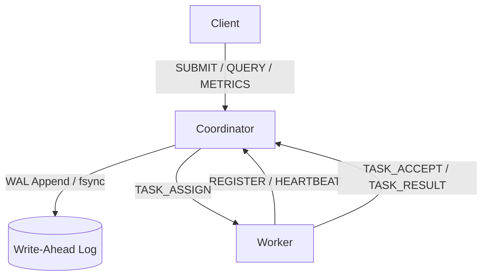

# Intelligent Distributed Runtime (IDR)

[](https://github.com/pavankumargp6/intelligent-distributed-runtime/actions/workflows/ci.yml)

IDR is a fault-tolerant, distributed task execution engine written in C. Built with Linux system programming primitives (sockets, `fork / execvp`, `poll`, signals, and a length-prefixed TCP protocol), it is designed to handle high-concurrency task bursts with strict durability guarantees, secure client/worker authentication, and a resource-aware scheduler.

## Architecture

The system follows a Coordinator-Worker architecture. The Coordinator manages state, handles scheduling, and writes to a Write-Ahead Log (WAL) for crash recovery. Workers pull tasks, report heartbeats, and manage process lifecycles.



### Execution flow

1. **Submit:** A client sends a task request to the coordinator.
2. **Validate and queue:** The coordinator validates the message,
   applies authentication in secure mode, and records accepted
   tasks using its write-ahead log (WAL).
3. **Schedule:** The scheduler assigns available work to registered
   workers.
4. **Execute:** A worker launches the command and reports the
   result to the coordinator.
5. **Observe:** Clients can query task results and runtime status;
   the metrics endpoint supplies data to the dashboard.

## Core Features

*   **Fault Tolerance:** Write-Ahead Logging (WAL) with crash recovery, WAL compaction, and worker reincarnation detection.
*   **Secure Networking:** TCP sockets secured with HMAC-SHA256 authentication, role-specific secrets, and replay protection.
*   **Resource-Aware Scheduling:** O(q) scan-and-swap scheduling that prevents Head-of-Line (HOL) blocking and distributes tasks fairly across workers.
*   **Process Isolation:** Tasks are executed in separate process groups (`setpgid`). Timeouts and failures use `kill(-pid)` to ensure descendant processes are terminated, leaving no orphans.
*   **Observability:** Real-time metrics client (`client_metrics`) and `STATUS` replies exposing throughput, latency, and active worker counts.

## Performance & Benchmarks

**Known limitation:** The benchmark harness measures ~50 TCP connections per task due to the current connection-per-request model. Reducing this via persistent connections with proper outgoing queues is future work.

The IDR coordinator is built to handle high-concurrency task bursts efficiently. Below are the results from a benchmark run using 4 local workers processing a queue of 1,000 no-op tasks.

**Hardware:** WSL2, Ubuntu (Windows 11 host)  
**Workload:** 1,000 tasks / 4 workers

| Metric | p50 (Median) | p95 (Tail) |
| :--- | :--- | :--- |
| **End-to-End Latency** | 15 ms | 29 ms |
| **Queue Wait Time** | 4 ms | 17 ms |

*   **Submission Throughput:** 3,618 tasks/sec
*   **Completion Throughput:** 1,000 tasks/sec (wall-clock)


## Live Observability Dashboard

The runtime includes a built-in, real-time observability dashboard.
1. Start the coordinator: `IDR_INSECURE=1 ./build/runtime_server`
2. Serve the dashboard: `cd dashboard && python3 -m http.server 8000`
3. Open `http://localhost:8000` in your browser.

The coordinator exposes a read-only JSON endpoint at `http://127.0.0.1:8080/api/metrics`. The dashboard polls this endpoint every second to display live queue depth, active workers, and task completion metrics.

## Protocol

Framing: `[4-byte network-order uint32 payload length][payload]`.
This section is a summary. The canonical reference is in `docs/PROTOCOL.md`. Payloads are newline-free ASCII. Variable-length string fields are length-prefixed as `<len>:<bytes>`.

*   **Submit a task:** `SUBMIT|<command_len>:<command>||argc||...args...|<idempotent>|<timeout_sec>`
*   **Task Assignment:** `TASK_ASSIGN||task_id||<command>|<argc>||...args...|<timeout_sec>`
*   **Result:** `TASK_RESULT|<task_id>||worker_id>||exit_code|<state>`
*   **State Codes:** `0=CREATED, 1=RUNNING, 2=COMPLETED, 3=FAILED, 4=TIMED_OUT``

**Example:** `SUBMIT|4:echo|2|5:hello|5:world|0|0`

## Authentication

Every message on the wire is signed with HMAC-SHA256 by default. The signed form is:
`<original_message>|<timestamp>|<hex_hmac>`

*   **Secure mode (default):** Requires `IDR_WORKER_SECRET` and `IDR_CLIENT_SECRET` (min 32 bytes). Every incoming message is verified, and outgoing responses are signed. Timestamps are checked with a 60-second replay window.
*   **Insecure development mode:** Enabled by `IDR_INSECURE=1`. Authentication is disabled, and the coordinator requires a loopback bind address.

*Note: HMAC authenticates but does not encrypt. The wire is still plaintext. TLS is out of scope for this version.*


## Building and Running

### Requirements

- Linux (Ubuntu 22.04/24.04 or a compatible distribution)
- GCC, Make, Git and iproute2 (`ss`)
- Python 3 for the optional dashboard

Install the dependencies on Ubuntu:

```bash
sudo apt update
sudo apt install -y build-essential git iproute2 python3
```

### Clone and build

```bash
git clone https://github.com/pavankumargp6/intelligent-distributed-runtime.git
cd intelligent-distributed-runtime
make
```

Run the complete test suite:

```bash
make test
```

The build creates the coordinator, worker agent and client
executables under `build/`.

### Quick demo: local development mode

This demo disables message authentication for local development.
Use it only on the loopback interface; do not use insecure mode
for network-accessible deployments.

Open three terminals in the cloned repository.

**Terminal 1 — start the coordinator**

```bash
rm -f /tmp/idr-demo-wal.log
IDR_INSECURE=1 IDR_WAL_PATH=/tmp/idr-demo-wal.log ./build/runtime_server
```

**Terminal 2 — start a worker**

```bash
IDR_INSECURE=1 ./build/worker_agent 1
```

**Terminal 3 — submit and query a task**

```bash
out=$(IDR_INSECURE=1 ./build/client_submit echo hello world)
printf '%s\n' "$out"

task_id=$(printf '%s\n' "$out" |
  sed -n 's/.*SUBMIT_ACK|\([0-9][0-9]*\).*/\1/p' |
  tail -n 1)

if [ -z "$task_id" ]; then
  echo "Could not obtain task ID"
  exit 1
fi

sleep 6
IDR_INSECURE=1 ./build/client_query "$task_id"
IDR_INSECURE=1 ./build/client_status
```

The query should report a completed task with exit code `0`.
The task ID is extracted from the submission response rather
than assumed to be `1`.

### Optional dashboard

In another terminal:

```bash
cd dashboard
python3 -m http.server 8000
```

Open http://localhost:8000 in your browser. The dashboard
uses the coordinator's metrics endpoint at
`http://127.0.0.1:8080/api/metrics`.

### Development checks

```bash
make asan
make ubsan
make analyzer
make clean
```

These targets build instrumented or analysis binaries, except
`make clean`, which removes the build directory. Building the
sanitizer binaries alone does not mean the test suite was run
under sanitizers.

## Limitations & Future Work

*   **Coordinator High Availability:** The coordinator is currently a single point of failure. A future iteration will implement Raft consensus for multi-node failover.
*   **Transport Encryption (TLS):** Authentication is enforced, but the wire protocol is currently plaintext.

* **Experimental namespace/chroot sandbox:** Setting
  `IDR_SANDBOX_DIR` enables the current Linux namespace and
  `chroot()` setup path. This is not a full container runtime or
  a security boundary suitable for arbitrary hostile code.
  Resource limits through cgroups, seccomp filtering, network
  namespace isolation and a comprehensive filesystem and
  capability policy are not yet provided. Environments that
  block the required system calls may skip the isolation test;
  a skipped test is not evidence of successful isolation.
*   **Executor Crash Detection:** If a worker's heartbeat continues but its forked task child segfaults, the coordinator relies on the task's `timeout_seconds` to detect the hang. A worker-side signal is required for instantaneous detection.

## License

This project is licensed under the MIT License. See the ``LICENSE` file for details.


[](https://hub.xerj.org/contributors/pavankumargp6)
