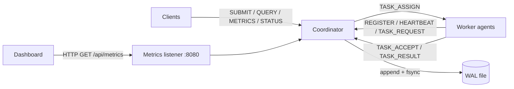
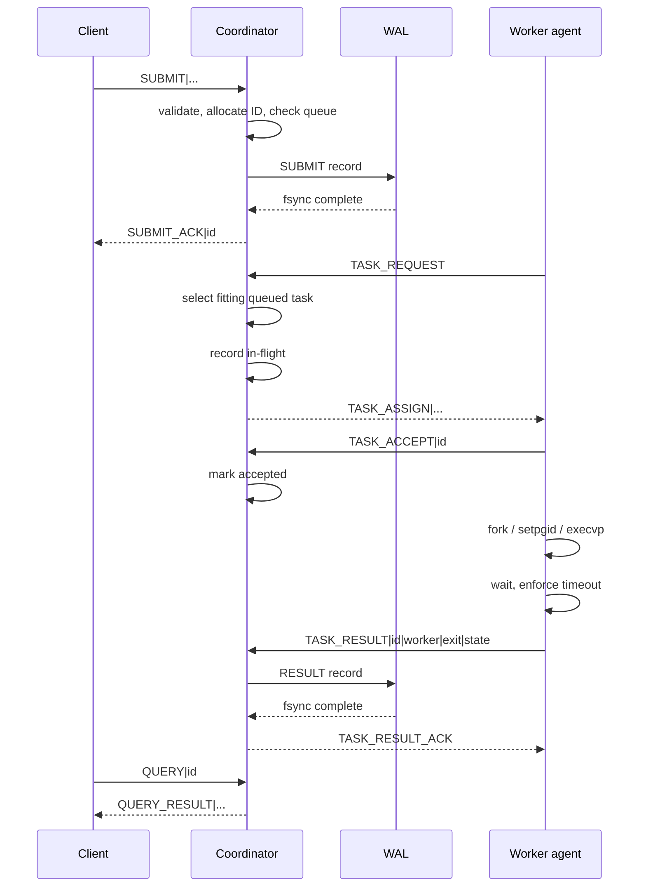

# IDR Architecture

Status: Current v0.x, with v1.0 targets called out
Last updated: 2026-11-15

This document describes the components of the Intelligent Distributed
Runtime, how a task moves through them, and which invariants the current
implementation maintains.

For the behavioral contract, see `docs/SEMANTICS.md`. For the wire
format, see `docs/PROTOCOL.md`. For decisions that change this
architecture, see `docs/adr/`.

## 1. Goals

IDR is a single-coordinator task execution engine for Linux. It aims to:

- accept tasks over a length-prefixed TCP protocol;
- authenticate clients and workers with HMAC-SHA256;
- durably record accepted tasks and their results in a write-ahead log;
- dispatch tasks to workers that pull work;
- execute each task in a separate process group with an optional timeout;
- expose queue, worker, and task metrics.

## 2. Non-goals for v0.x

- multi-node coordinator consensus;
- transport encryption;
- per-client identity and authorization;
- exactly-once side effects;
- hostile multi-tenant isolation;
- WAL or snapshot format stability;
- remote worker discovery.

These are roadmap items or explicit non-goals. See `docs/ROADMAP.md`.

## 3. Topology



The current deployment model is one coordinator process and one or more
worker agent processes on the same host. The coordinator binds to
`127.0.0.1:5001`; `IDR_BIND_ADDR` changes the address, but the port is
compiled in. Clients, worker agents, and test programs hard-code
`127.0.0.1` and port 5001, so a remote worker cannot connect without a
rebuild. Making the endpoint configurable is a Phase 2 item.

## 4. Components

### 4.1 Coordinator (`runtime_server`)

Responsibilities:

- accept and authenticate connections;
- parse submissions, queries, status requests, and metrics requests;
- allocate task IDs;
- append `SUBMIT` and `RESULT` records to the WAL and fsync them;
- enqueue tasks and dispatch them to requesting workers;
- track in-flight tasks and recent completed results;
- detect stale workers and reap their tasks;
- expose a JSON metrics endpoint;
- replay the WAL at startup.

The coordinator is single-threaded. A `poll()` loop drives:

- the listening socket;
- up to 64 connection state machines;
- the metrics listener;
- periodic worker-liveness and task-reaping work, at most once per
  second.

Connection sockets are non-blocking and have a 5-second idle timeout.
The metrics listener is the exception: it performs a blocking `recv()`
after `accept()`, so a local client that connects and sends nothing can
stall the event loop. This is a known defect and a Phase 5 fix.

### 4.2 Worker agent (`worker_agent`)

Responsibilities:

- register with the coordinator;
- send heartbeats;
- request one task at a time;
- send `TASK_ACCEPT`;
- fork a child, place it in a new process group, and execute the task;
- wait for the child, enforce the execution timeout, and report the
  result.

The parent process installs `SIGCHLD` with `SIG_IGN`, so exited children
are reaped automatically by the kernel. The parent does not wait for a
task child before requesting the next task. Concurrency is therefore
bounded only by the coordinator's 64-entry in-flight table, not by
worker capacity.

The default agent poll interval is 0 seconds, despite a stale comment
that says 3 seconds. This makes the default worker poll aggressively.

### 4.3 Clients

The repository builds four small clients:

- `client_submit` - submit a task and print the acknowledgement;
- `client_query` - query a task ID;
- `client_status` - print coordinator status;
- `client_metrics` - request the coordinator's task metrics.

They are demonstration and test clients, not a general SDK.

### 4.4 Dashboard

`dashboard/index.html` polls `http://127.0.0.1:8080/api/metrics` once per
second and renders queue depth, worker counts, and task counters.

### 4.5 Metrics listener

The coordinator opens a second TCP listener on port 8080. It answers any
request with a small JSON document:

```json
{
  "queue": 0,
  "inflight": 0,
  "submitted": 0,
  "completed": 0,
  "failed": 0,
  "timed_out": 0,
  "avg_queue_wait_ms": 0.00,
  "avg_exec_ms": 0.00
}
```

The endpoint is read-only and unauthenticated, and is intended for
loopback use.

## 5. Task flow



Important ordering properties:

1. `SUBMIT_ACK` is sent only after the `SUBMIT` record is fsynced and the
   task is queued.
2. `TASK_RESULT_ACK` is sent only after the `RESULT` record is fsynced.
3. If the WAL append fails, the coordinator refuses to acknowledge the
   submission or result.

For results, "refuses to acknowledge" does not mean "leaves state
unchanged": the in-flight entry is removed before the append. A failed
result append therefore drops the result from memory. See section 10.

## 6. Scheduling

Workers pull work. The coordinator does not push from a global loop.

Current algorithm:

1. A worker sends `TASK_REQUEST` with its worker ID.
2. The coordinator verifies that the worker is registered and live.
3. It scans the FIFO queue for the first task whose CPU and memory
   requirements fit the worker.
4. If the fitting task is not at the front, it swaps that task with the
   front and dequeues it. This avoids head-of-line blocking.
5. The task is recorded in the in-flight table and sent as
   `TASK_ASSIGN`.

The fit check compares the task's requested CPU and memory against the
worker's advertised `available_cpu_percent` and
`available_memory_mb`.

Current limitation: those availability values are set equal to the
worker's total capacity at registration and are never updated by
heartbeats or running tasks. The scheduler therefore performs static
capacity filtering, not live load-aware scheduling. A single worker can
be assigned the entire in-flight window.

v1.0 target:

- slots as the primary admission control;
- heartbeat-reported running count, free slots, load, and epoch;
- coordinator-side reservations released on result, timeout, or reap;
- fair-share and priority policies;
- queue high-water marks and explicit backpressure.

## 7. Durability

### 7.1 WAL format

The WAL is a newline-delimited text file. Each line is one of:

```
SUBMIT|<task_id>|<command field>|<argc>|<arg fields>|<idempotent>|<timeout>
RESULT|<task_id>|<worker_id>|<exit_status>|<state>
```

Variable-length string fields use the same `<length>:<bytes>` encoding as
the wire protocol. Records are written with a single `write()` call and
fsynced before `wal_append()` returns.

The WAL has no magic number, format version, or per-record checksum.
`wal_foreach_line()` skips malformed lines with a warning. A torn final
record is therefore treated similarly to mid-file corruption; v1.0 will
distinguish them and add checksums.

### 7.2 Startup compaction

Before replay, the coordinator scans the WAL and rewrites it through a
temporary file plus `fsync` and `rename`.

The current compaction policy keeps every `SUBMIT` and `RESULT` line for
any task ID it knows about. It does not drop completed tasks. The code
comment explains why: dropping the `SUBMIT` would lose the command,
arguments, idempotency flag, and timeout needed by recovery.

The result is that the WAL does not shrink. Recovery and compaction are
both capped at `RECOVERY_MAX_TASKS` (4,096 unique tasks). After 4,096
lifetime tasks:

- compaction logs `wal_compact_index_full` and is skipped;
- replay logs `wal_recovery_overflow` and refuses to start;
- the coordinator exits with `wal_replay_failed`.

This is the most important durability defect in v0.x. ADR-001 defines
the snapshot-and-segment replacement.

### 7.3 Recovery

Recovery buffers up to 4,096 submissions and 4,096 results in static
arrays, then:

- restores completed results into the 64-entry completed ring;
- tries to requeue every submission without a matching result;
- sets `next_task_id` to the maximum seen ID plus one;
- reconstructs submission, completion, failure, and timeout counters.

The requeue step is bounded by the 64-entry task queue. If a crash leaves
more than 64 unfinished tasks, only the first 64 are queued in memory;
the rest stay in the WAL and are not scheduled until a later restart
re-reads them.

Recovery does not consult the `idempotent` flag. Any task without a
recorded result is retried. ADR-002 defines the target policy.

## 8. Authentication and authorization

### 8.1 Authentication

Every message in secure mode is signed as:

```
<message>|<timestamp>|<hex HMAC-SHA256>
```

The MAC input is:

```
IDR-AUTH-V1|<direction>|<role>|<timestamp>|<message>
```

The coordinator verifies:

- the timestamp is no more than 60 seconds in the past and no more than
  5 seconds in the future;
- the MAC matches the role-specific secret;
- the MAC has not been seen in the replay cache within the timestamp
  window.

The replay cache holds 8,192 MACs and fails closed when full. At the
60-second window, that sustains roughly 136 verifications per second
continuously. Above that rate, valid messages can be rejected until
entries expire.

Authentication failures close the connection without a response. This
avoids revealing whether the MAC, timestamp, or message type failed.

### 8.2 Authorization

There is no authorization layer beyond role. Any holder of
`IDR_CLIENT_SECRET` can submit any command and query any task. Any
holder of `IDR_WORKER_SECRET` can register any worker ID, accept any
in-flight task, and report any result. Worker identity and fencing are
the subject of ADR-003.

### 8.3 Insecure mode

`IDR_INSECURE=1` disables authentication. The coordinator refuses to
start in this mode unless the bind address is loopback. This is a
development convenience, not a deployment mode.

## 9. Execution isolation

The worker executes the command directly with `execvp`; there is no
shell.

Each task child calls `setpgid(0, 0)` before `exec`. On timeout or
failure, the worker sends `SIGKILL` to `-pid`, which reaches the child
and its descendants in the same process group.

If `IDR_SANDBOX_DIR` is set, the child enters new user, UTS, and mount
namespaces, maps its UID/GID, sets a hostname, makes mounts private, and
`chroot()`s into the sandbox directory. This path is experimental. It is
not a seccomp, cgroup, network-isolation, or capability boundary, and it
is not safe for arbitrary hostile code.

## 10. Failure handling

| Failure | Current behavior | v1.0 target |
|---|---|---|
| Client disconnects before ACK | Task may or may not exist; retry can duplicate | Optional idempotency key |
| Worker never accepts | 15-second dispatch timeout; idempotent requeue, non-idempotent fail | Same, with WAL `DISPATCH` record |
| Worker stops heartbeating | After 10 seconds, all its in-flight tasks fail | Idempotent requeue, non-idempotent `UNKNOWN` |
| Worker re-registers with same ID | In-flight tasks from old incarnation fail | Epoch fencing plus idempotent requeue |
| Task child crashes | Runner reports `FAILED` | Same |
| Worker cannot start the task after `TASK_ACCEPT` | Runner exits without a `RESULT`; the task stays in flight while the worker keeps heartbeating | Worker reports `FAILED` for every start or wait failure |
| Result WAL append fails | Task was already removed from in-flight; no ACK is sent, the worker does not retry, and the result is dropped until restart | Keep the task in flight until the `RESULT` record is durable; worker retries with backoff |
| Task child hangs with heartbeat alive | Only task timeout stops it | Same, plus optional coordinator deadline |
| Coordinator crashes | WAL replay; all unfinished tasks requeued | Snapshot plus idempotency-aware replay |
| WAL append fails | Coordinator refuses ACK | Same, plus readiness signal and alert |
| WAL reaches 4,096 tasks | Coordinator refuses to restart | Segment truncation removes the cliff |
| Metrics client stalls | Event loop blocks in `recv()` | Non-blocking metrics state machine |
| Disk full | Append fails, ACK is refused | Same, plus health/readiness and runbook |

## 11. Concurrency and memory model

- Coordinator: single-threaded, `poll()`-driven, no locks.
- Worker parent: single-threaded; children run independently.
- All coordinator state is process-local and non-shared.
- Task queues, in-flight entries, completed results, workers, and
  connections are fixed-size arrays.
- The WAL is the only durable state.
- Metrics counters are process-lifetime and reset on restart.

This model is simple and easy to reason about. It is also why a blocking
call in the event loop is a global stall, and why dynamic structures are
needed before increasing the fixed limits.

## 12. Limits

| Constant | Value | Location |
|---|---|---|
| Queue capacity | 64 | `src/task_queue.h` |
| In-flight tasks | 64 | `src/coordinator_tasks.h` |
| Completed results | 64 | `src/coordinator_tasks.h` |
| Worker pool | 16 | `src/worker_pool.h` |
| Worker registry | 32 | `src/worker_registry.h` |
| Connection pool | 64 | `src/connection_pool.h` |
| Recovery tasks | 4,096 | `src/recovery.c` |
| WAL line | 8,192 bytes | `src/wal.c` |
| Protocol message | 4,096 bytes | `src/network_protocol.h` |
| Command | 256 bytes | `src/task.h` |
| Arguments | 16 x 128 bytes | `src/task.h` |
| Replay cache | 8,192 MACs | `src/auth.h` |
| Heartbeat timeout | 10 seconds | `src/worker_registry.h` |
| Dispatch timeout | 15 seconds | `src/coordinator_tasks.h` |
| Connection idle timeout | 5 seconds | `src/connection_pool.h` |

## 13. Design decisions

- `docs/adr/0001-snapshot-and-wal-segmentation.md`
- `docs/adr/0002-delivery-semantics.md`
- `docs/adr/0003-worker-identity-and-fencing.md`

## 14. What this architecture is not

IDR is not a container orchestrator, a general-purpose job queue for
untrusted code, a replicated database, or a security boundary. It is a
compact systems project that demonstrates durable task submission,
process-level execution, scheduling, and failure recovery. The roadmap
closes the gap between that demonstration and a production service.
