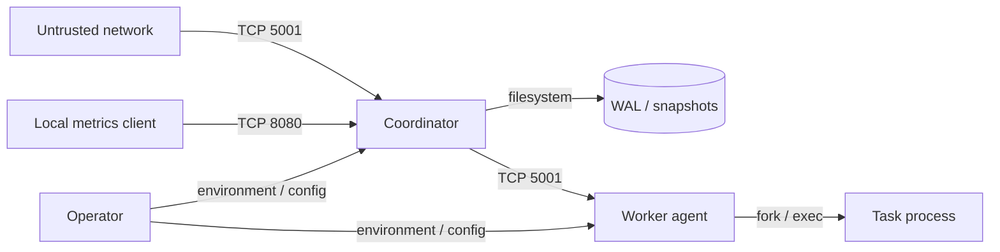

# IDR Threat Model

Status: Current v0.x, with v1.0 mitigations called out
Last updated: 2026-11-15

This document describes the assets IDR protects, the trust boundaries it
assumes, the adversaries it considers, and the gaps between the current
implementation and the v1.0 security baseline.

It is a design and review document, not a certification.

## 1. Scope and assumptions

In scope:

- the coordinator, worker agent, clients, dashboard, and metrics listener;
- the wire protocol and authentication scheme;
- the WAL and snapshot files;
- task execution on worker hosts;
- the build and CI pipeline.

Assumptions:

- the host operating system and kernel are trusted;
- the operator provisions secrets and file permissions correctly;
- the network may be hostile;
- workers run on hosts that are at least as trusted as the coordinator;
- task code is not trusted to be benign unless the sandbox is enabled
  and has been independently reviewed.

## 2. Assets

| Asset | Why it matters |
|---|---|
| Task commands and arguments | May contain credentials, paths, or business logic |
| Task results and exit codes | Drive downstream decisions |
| Worker CPU, memory, and process table | Exhaustion causes denial of service |
| `IDR_CLIENT_SECRET` and `IDR_WORKER_SECRET` | Full role compromise if leaked |
| WAL and snapshot integrity | Loss or forgery breaks durability |
| Coordinator availability | Single point of failure in v0.x |
| Worker host filesystem and credentials | Task code runs with worker privileges |
| Audit and metrics data | Needed to detect abuse and failures |

## 3. Trust boundaries

Boundaries:

1. **Network to coordinator**: unauthenticated until HMAC verification.
2. **Coordinator to disk**: local filesystem, trusted but not checksummed
   in v0.x.
3. **Worker agent to task process**: the task is untrusted code running
   with the worker's UID unless the experimental sandbox is enabled.
4. **Local process to metrics listener**: unauthenticated loopback HTTP.
5. **Operator to configuration**: secrets are supplied through the
   environment in v0.x.
6. **CI to release artifacts**: GitHub Actions and build dependencies.

## 4. Adversaries

| Adversary | Capability |
|---|---|
| Network attacker | Can connect, send arbitrary bytes, replay, delay, drop, or modify traffic |
| Malicious client with `IDR_CLIENT_SECRET` | Can submit arbitrary commands, query any task, and consume queue capacity |
| Malicious worker with `IDR_WORKER_SECRET` | Can register any worker ID, accept tasks, and report results |
| Local unprivileged user on a host | Can connect to loopback ports, read world-readable files, inspect processes |
| Malicious task code | Runs with worker privileges and can attack the worker host |
| Operator error | Misconfiguration, accidental secret exposure, destructive recovery |
| Supply-chain attacker | Compromises a dependency, CI action, or release artifact |

## 5. Threats and current mitigations

### 5.1 Spoofing

| ID | Threat | Current mitigation | Gap | Target |
|---|---|---|---|---|
| S1 | Impersonate a client or worker | HMAC-SHA256 with role-specific shared secrets | One secret per role, not per identity | Per-client and per-worker credentials |
| S2 | Register an arbitrary worker ID | Requires the worker secret | Any worker can claim any ID | Enrollment binds ID to credential |
| S3 | Accept another worker's task | Requires the worker secret | `TASK_ACCEPT` has no worker ID | Signed worker ID plus epoch |
| S4 | Report another worker's result | Requires the worker secret | `TASK_RESULT` worker ID is not checked against the assignment | Assignment ownership check plus fencing |

### 5.2 Tampering

| ID | Threat | Current mitigation | Gap | Target |
|---|---|---|---|---|
| T1 | Modify a message in transit | HMAC over message, role, direction, timestamp | Transport is plaintext; framing length is outside the MAC | TLS 1.3 for confidentiality and integrity |
| T2 | Modify the WAL | Filesystem permissions only; file is created mode 0644 | No checksums or version marker | Mode 0600, per-record checksums, atomic snapshots |
| T3 | Replay a valid message | 60-second window plus 8,192-entry replay cache; fail closed | Cache is global and can be filled by one identity | Per-identity replay protection, nonces, rate limits |
| T4 | Forge a result after worker replacement | None | Stale worker can still report | Worker epoch/fencing token |
| T5 | Downgrade authentication | `IDR-AUTH-V1` is inside the MAC input | No negotiation or version policy | Version negotiation and deprecation policy |

### 5.3 Repudiation

| ID | Threat | Current mitigation | Gap | Target |
|---|---|---|---|---|
| R1 | Deny submitting a task | Logs include task ID and command for accepted tasks | No per-client identity, no signed audit log | Authenticated client IDs and append-only audit records |
| R2 | Deny reporting a result | Logs include task, worker, exit status, and state | Worker identity is not authenticated beyond the shared role secret | Per-worker identity and signed result records |

### 5.4 Information disclosure

| ID | Threat | Current mitigation | Gap | Target |
|---|---|---|---|---|
| I1 | Read task commands or results on the wire | HMAC authenticates but does not encrypt | Plaintext TCP | TLS 1.3 |
| I2 | Read the WAL | File mode 0644 by default | Other local users can read task history | Mode 0600, documented directory permissions |
| I3 | Read secrets from the environment | Environment variables are the only configuration path | `/proc/<pid>/environ` exposure to same-user processes; secrets in shell history | Secret files with strict permissions, optional secret manager |
| I4 | Read metrics without authorization | Listener is loopback-only | Any local process can read queue and worker data | Authenticated or Unix-domain-socket metrics endpoint |
| I5 | Leak task data in logs | JSON logging escapes control characters | Commands and task IDs are logged; arguments are not | Redaction policy and log levels |

### 5.5 Denial of service

| ID | Threat | Current mitigation | Gap | Target |
|---|---|---|---|---|
| D1 | Exhaust the connection pool | 64 connections, 5-second idle timeout | An attacker can hold all 64 slots for 5 seconds per connection | Per-IP limits, authentication deadlines, epoll scaling |
| D2 | Fill the replay cache | 8,192 entries; fail closed | One identity can consume the cache and reject valid traffic | Per-identity caches and rate limits |
| D3 | Fill the task queue | 64 slots; `SUBMIT_REJECT` | No priority or per-client quota | Weighted fair queue and client quotas |
| D4 | Stall the coordinator via metrics | None | Blocking `recv()` on accepted metrics socket | Non-blocking metrics state machine or separate thread |
| D5 | Fork-bomb a worker | Coordinator in-flight table caps tasks at 64 | Worker has no child cap and never waits for children | Worker child supervisor with a hard slot limit |
| D6 | Submit oversized or expensive tasks | 4,096-byte messages, 256-byte commands, 16 arguments | No CPU, memory, or wall-clock quota at submission | Resource limits and admission control |
| D7 | Slowloris the coordinator | Framing has a 4,096-byte maximum; idle connections expire in 5 seconds | No per-connection read deadline during framing | Per-state deadlines and authentication timeouts |
| D8 | Exhaust worker memory or CPU | Optional per-task timeout | No cgroups or rlimits | cgroups v2 and rlimits in the sandbox |
| D9 | Exhaust disk with WAL growth | None; WAL never shrinks | A long-running deployment eventually fills the disk and then hits the 4,096-task recovery cliff | Snapshots, segment truncation, disk-space readiness check |

### 5.6 Elevation of privilege

| ID | Threat | Current mitigation | Gap | Target |
|---|---|---|---|---|
| E1 | Run arbitrary commands through a client credential | Client secret is required in secure mode | Any client credential is fully authorized | Command policy, quotas, and per-client authorization |
| E2 | Escape the task sandbox | Process group plus optional user/mount/UTS namespaces and `chroot()` | No seccomp, cgroups, network namespace, or capability policy; `chroot()` alone is not a boundary | seccomp-bpf, cgroups v2, all namespaces, rlimits, no-new-privileges |
| E3 | Use a worker credential to influence another worker's task | Shared role secret | No assignment ownership check | Per-worker credentials and fencing |
| E4 | Compromise a release through CI | GitHub Actions build and test | Actions are pinned by tag, not commit SHA; no artifact signing | Pin SHAs, least-privilege tokens, signed releases |

## 6. Current security controls

The current implementation has these controls:

- HMAC-SHA256 authentication with role-specific secrets and a 32-byte
  minimum secret length;
- timestamp validation with a 60-second past window and 5-second future
  window;
- a bounded replay cache that fails closed;
- silent connection close on authentication failure;
- loopback-only enforcement in insecure mode;
- direct `execvp` without a shell;
- process-group creation and `SIGKILL(-pid)` on timeout;
- optional user, UTS, and mount namespaces plus `chroot()`;
- per-record WAL `fsync` before acknowledgement;
- maximum message, command, argument, and WAL line sizes.

These controls are tested by the existing suite:

- SHA-256 and HMAC-SHA256 known-answer tests, including RFC 4231 vectors;
- wrong-role rejection;
- missing-secret refusal;
- replay detection, timestamp expiry, and full-cache behavior;
- insecure-mode bind-address refusal;
- namespace and sandbox failure tests;
- WAL corruption and recovery tests;
- hung-client and connection-pool tests.

## 7. Accepted risks in v0.x

These are known and accepted for the current pre-1.0 version:

- plaintext transport;
- shared role secrets instead of per-identity credentials;
- no coordinator high availability;
- no protection from a malicious client that holds a valid client
  secret;
- no protection from a malicious worker that holds a valid worker
  secret;
- no strong sandbox for hostile code;
- no audit trail suitable for compliance;
- no secret rotation;
- no rate limiting;
- no disk-space or WAL-growth protection.

The README and `docs/SEMANTICS.md` must not imply that these risks are
covered.

## 8. Security roadmap

| Phase | Work |
|---|---|
| 1 | WAL checksums, versioned snapshots, mode 0600, disk-space readiness |
| 2 | Per-worker identity, epochs, assignment ownership checks |
| 3 | Connection scaling, per-IP limits, request deadlines |
| 4 | TLS 1.3, per-client credentials, quotas, seccomp/cgroups, fuzzing |
| 5 | Authenticated metrics, audit logging, release signing |
| 6 | Leader and worker fencing under failover |

## 9. Security testing plan

- Keep the existing known-answer, wrong-role, replay, and sandbox tests.
- Add protocol and WAL parser fuzz targets with a checked-in corpus.
- Run short fuzz jobs on every pull request and long jobs nightly.
- Add an authentication-bypass test matrix for every message type.
- Add a sandbox escape test suite before calling the sandbox a boundary.
- Add dependency and CI-action pinning checks.
- Commission an external review before a production 1.0 claim.

## 10. Reporting

A formal vulnerability disclosure policy will be added in Phase 4. Until
then, do not publish suspected vulnerabilities in a public issue. Use a
private channel to the maintainer and include:

- affected version or commit;
- reproduction steps;
- impact assessment;
- whether the issue is already public.

## 11. Out of scope

- kernel or hypervisor compromise;
- physical access;
- side-channel attacks;
- network-edge DDoS mitigation;
- multi-tenant isolation for arbitrary hostile code;
- compliance certification;
- supply-chain compromise outside the repository's CI configuration.

## References

- `docs/ARCHITECTURE.md` - components and failure behavior
- `docs/SEMANTICS.md` - durability and delivery claims
- `docs/PROTOCOL.md` - authentication and wire format
- `docs/ROADMAP.md` - mitigation schedule
